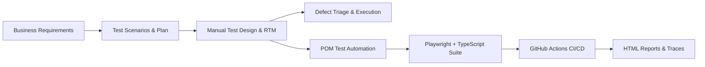

# 🛍️ OpenCart End-to-End QA & Automation Portfolio

[](https://github.com/sandip95-web/opencart-qa-automation/actions/workflows/playwright.yml)
[](https://www.typescriptlang.org/)
[](https://playwright.dev/)
[](https://pnpm.io/)
[](#-portfolio-quick-access)

An industry-grade **Quality Assurance and Test Automation Showcase** developed for the **OpenCart E-Commerce** platform. 

This repository demonstrates a complete, dual-track QA strategy:
1. **Manual Testing Rigor:** IEEE 829-aligned Test Planning, 18-module Test Case Suite, Requirements Traceability Matrix (RTM), execution reporting, and defect triage.
2. **Software Automation Architecture:** Scalable, resilient **Playwright + TypeScript** framework leveraging the **Page Object Model (POM)** pattern, dynamic data generation, security/XSS testing, responsive viewport validation, and **GitHub Actions CI/CD**.

---

## 🧭 Portfolio Quick Access

For recruiters and engineering leaders looking for specific deliverables:

| Deliverable Area | Description | Direct Link |
| :--- | :--- | :--- |
| 📋 **Manual Testing Portfolio** | Test Plan, 18-module Test Cases, RTM, Execution Metrics, Bug Reports, and Google Sheets links | [👉 View Manual Testing Docs](docs/manual-testing/README.md) |
| 🤖 **Automation Architecture** | Framework design, Page Object Model, 22 automated Cart tests, locators, and CI/CD pipeline | [👉 View Automation Docs](docs/automation-testing/README.md) |
| 📊 **Live Test Deliverables** | Direct links to live collaborative Google Sheets (Test Plan, Cases, RTM, Bugs) | [👉 Open Sheets Links](docs/manual-testing/README.md#-core-manual-testing-deliverables) |

---

## 🏗️ End-to-End QA Workflow



---

## 📊 Test Suite & Coverage Highlights

### 1. Manual Testing (18 Functional Modules)
- **Scope:** Full coverage of e-commerce customer journeys including Account Management (Register, Login, Password, Address), Product Discovery (Search, Currency Switching, Compare), Transactions (Add to Cart, Shopping Cart, Wishlist, Orders), and Compliance.
- **Artifacts:** Maintained live in Google Sheets and versioned locally in [`sheet.xlsx`](./sheet.xlsx).

### 2. Automated Test Suite (Playwright + TypeScript)
- **Shopping Cart Module (`TS-010`):** 22 comprehensive automated tests ([`tests/cart.spec.ts`](./tests/cart.spec.ts)) covering:
  - Table rendering, breadcrumbs, column attributes, and button actions.
  - Quantity updates, zero-quantity removal, and invalid input boundary handling.
  - Mathematical calculation validations (`Sub-Total + Eco Tax + VAT = Total`).
  - Stock limits and checkout restrictions for unavailable inventory.
  - Security validation: Script injection / XSS prevention in quantity inputs.
  - Responsive layout validation (Mobile 375x667 viewport).
- **User Registration Module:** Automated end-to-end registration flow ([`tests/registration.spec.ts`](./tests/registration.spec.ts)) with dynamic data generation.

---

## 📁 Repository Structure

```text
opencart/
├── .github/
│   └── workflows/
│       └── playwright.yml         # Automated CI pipeline
├── docs/
│   ├── manual-testing/            # Manual QA Strategy & Google Sheets links
│   │   └── README.md
│   └── automation-testing/        # Framework Architecture & Test Coverage guide
│       └── README.md
├── pages/                         # Page Object Model (POM) classes
│   ├── CartPage.ts
│   └── RegistrationPage.ts
├── test-data/                     # Decoupled test fixtures & dynamic generators
│   ├── cart-data.ts
│   └── registration-data.ts
├── tests/                         # Playwright test spec suites
│   ├── cart.spec.ts               # 22 automated Cart scenarios
│   └── registration.spec.ts       # Registration scenarios
├── playwright.config.ts           # Playwright framework configuration
├── package.json                   # Project scripts and dependencies
├── pnpm-lock.yaml                 # Dependency lockfile
└── sheet.xlsx                     # Master manual testing workbook
```

---

## ⚡ Quick Start (Automation Execution)

### Prerequisites
- Node.js 18+ installed
- pnpm installed (`npm install -g pnpm`)

### Run Tests in 3 Steps

```bash
# 1. Install dependencies
pnpm install

# 2. Install Playwright browser binaries
pnpm exec playwright install --with-deps

# 3. Execute all automated tests
pnpm test
```

### Useful Commands

```bash
# Run tests with live browser window
pnpm run test:headed

# Launch Playwright Interactive UI Mode
pnpm run test:ui

# View rich HTML test execution report
pnpm run report
```

---

## 👤 Author & QA Profile

- **Name / Role:** Senior QA Engineer & Automation Architect
- **Specialization:** End-to-End Test Automation (Playwright, Cypress, Selenium), STLC, Test Strategy, CI/CD Integration
- **LinkedIn:** [linkedin.com/in/YOUR_LINKEDIN_PROFILE](https://linkedin.com/in/YOUR_LINKEDIN_PROFILE)
- **GitHub:** [github.com/sandip95-web](https://github.com/sandip95-web)
- **Email:** your.email@example.com
