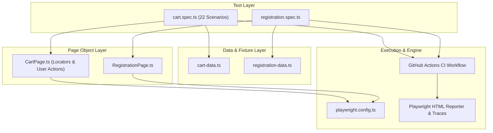

# 🤖 OpenCart Test Automation Architecture & Framework Guide

This document outlines the architecture, design principles, test design patterns, and execution workflows of the **Playwright + TypeScript** End-to-End Test Automation Suite for OpenCart.

---

## 🏗️ Architecture Overview

The framework is architected using the **Page Object Model (POM)** pattern to ensure clean separation of concerns, high maintainability, and zero test flakiness.



---

## 🛠️ Technology Stack

| Technology | Purpose | Key Benefits |
| :--- | :--- | :--- |
| **[Playwright](https://playwright.dev/)** (v1.64+) | E2E Testing Engine | Auto-waiting, multi-tab/iframe support, trace viewer, network interception |
| **TypeScript** | Scripting & Typing | Type safety, autocomplete, early detection of syntax and schema errors |
| **pnpm** (v12.14+) | Package Manager | Ultra-fast, disk space-efficient package resolution via symlinked content store |
| **GitHub Actions** | CI/CD Pipeline | Automated regression on every push and PR with automated test artifact retention |
| **Page Object Model (POM)** | Design Pattern | Decouples locator logic from test logic for maximum maintainability |

---

## 📂 Framework Directory Structure

```text
opencart/
├── .github/
│   └── workflows/
│       └── playwright.yml        # CI/CD pipeline definition
├── pages/                        # Page Object Model Layer
│   ├── CartPage.ts               # Encapsulates cart actions, locators, and calculations
│   └── RegistrationPage.ts       # Encapsulates account registration actions
├── test-data/                    # Test Data & Configuration Layer
│   ├── cart-data.ts              # Products, credentials, and test payloads (e.g. XSS)
│   └── registration-data.ts      # Dynamic user data generator (unique emails, passwords)
├── tests/                        # Test Execution Layer (Spec Files)
│   ├── cart.spec.ts              # 22 automated E2E tests for Shopping Cart (TS-010)
│   └── registration.spec.ts      # Automated registration flow (TC-RF-001)
├── playwright.config.ts          # Playwright test engine configuration
├── package.json                  # Dependencies and execution scripts
└── pnpm-lock.yaml                # Locked dependency tree
```

---

## 🧪 Automated Test Suite Breakdown

### 1. Shopping Cart Module (`tests/cart.spec.ts`)
The Cart module implements **22 automated tests** mapped 1-to-1 with manual test case IDs:

| Test Case ID | Priority | Test Scenario Description |
| :--- | :--- | :--- |
| `TC-CT-001` | High | Verify Shopping Cart table content, columns, and navigation breadcrumb |
| `TC-CT-002` | Medium | Verify clicking product link opens corresponding product page |
| `TC-CT-003` | High | Verify updating item quantity updates sub-total and header cart badge |
| `TC-CT-004` | High | Verify removing single product updates summary totals |
| `TC-CT-005` | Medium | Verify empty cart message when last product is removed |
| `TC-CT-006` | High | Verify mathematical calculation: `Total = Sub-Total + Eco Tax + VAT` |
| `TC-CT-007` | Medium | Verify consistency between header cart dropdown and Shopping Cart page |
| `TC-CT-008` | High | Verify line item total equals `Unit Price × Quantity` |
| `TC-CT-009` | High | Verify stock boundary warning (`***`) on quantities exceeding inventory |
| `TC-CT-010` | High | Verify checkout restriction when out-of-stock items exist |
| `TC-CT-011` | Medium | Verify updating item quantity to `0` removes item from cart |
| `TC-CT-012` | Medium | Verify cart resilience against invalid quantity inputs (negative & non-numeric) |
| `TC-CT-013` | Low | Verify button tooltips for Update and Remove controls |
| `TC-CT-014` | Medium | Verify 'Continue Shopping' redirects to catalog |
| `TC-CT-015` | High | Verify 'Checkout' button transitions to checkout workflow |
| `TC-CT-016` | Medium | Verify coupon, voucher, and shipping estimation accordions |
| `TC-CT-017` | Medium | Verify validation warning for invalid/expired coupon codes |
| `TC-CT-018` | Low | Verify total weight display in Shopping Cart heading |
| `TC-CT-019` | Low | Verify reward points display for eligible products |
| `TC-CT-020` | Medium | **Security:** Verify XSS injection payload in quantity field is not executed |
| `TC-CT-021` | Medium | **Cross-Engine:** Verify cart UI layout rendering stability across engines |
| `TC-CT-022` | Medium | **Mobile Responsive:** Verify cart controls and table rendering at 375x667 viewport |

### 2. User Registration (`tests/registration.spec.ts`)
- `TC-RF-001`: Verifies that a new user can successfully register with dynamic data generator, privacy policy agreement, and confirmation screen assertion.

---

## 🚀 Local Execution Guide

### Prerequisites
- **Node.js**: v18 or later (LTS recommended)
- **pnpm**: v9 or v12 (`npm install -g pnpm`)

### 1. Installation
Clone the repository and install dependencies:
```bash
# Clone the repository
git clone https://github.com/sandip95-web/opencart-qa-automation.git
cd opencart-qa-automation

# Install project dependencies
pnpm install

# Install Playwright browser binaries with system dependencies
pnpm exec playwright install --with-deps
```

### 2. Running Tests
You can execute tests across several modes:

```bash
# Run all tests headlessly
pnpm test

# Run tests in headed browser mode (watch execution live)
pnpm run test:headed

# Launch Playwright Interactive UI Mode (time-travel debugging)
pnpm run test:ui

# Run only the Cart test suite
pnpm exec playwright test tests/cart.spec.ts

# Run a single test scenario by Test ID
pnpm exec playwright test -g "TC-CT-006"
```

### 3. Viewing Test Reports
After test execution, launch the rich HTML report:
```bash
pnpm run report
```
If a test fails on CI or locally, Playwright automatically attaches:
- **Trace files** (Inspect DOM snapshots, network requests, console logs at every micro-step)
- **Video / Screenshots**
- **Error call stacks**

---

## ⚙️ Continuous Integration (GitHub Actions)

The repository includes a ready-to-use CI pipeline located at [`.github/workflows/playwright.yml`](../../.github/workflows/playwright.yml).

- **Triggers**: Executed automatically on every `push` or `pull_request` to `main` and `master`.
- **Environment**: Ubuntu Latest container with automated Node.js caching and pnpm setup.
- **Reporting**: Artifacts (`playwright-report`) are preserved for 30 days for every build.

---

## 🌟 Best Practices Followed
1. **Resilient Locators:** Preferred user-facing locators (`getByRole`, `getByText`, accessible labels) over brittle XPath or CSS selectors.
2. **Auto-Waiting:** Avoided arbitrary `sleep` timeouts; relied on Playwright's built-in web-first assertions and actionability checks.
3. **Dynamic Test Data:** Dynamic timestamp-based generators ensure test independence and zero state leakage between test runs.
4. **Clean Code & Strict Linting:** Modular page helper methods, readable assertions, and organized imports.

👉 For manual test designs, RTM, and defect reports, see [Manual Testing Documentation](../manual-testing/README.md).
